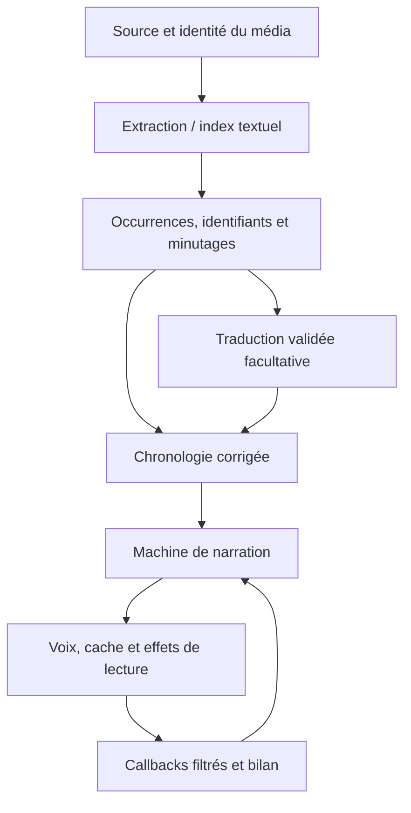

# Architecture et invariants — 1.0.0

[Index](README.md) · [Contribution](../CONTRIBUTING.md) · [Validation](../TESTING.md) · [Référence détaillée antérieure](archives/architecture-avant-1.0.0.md)

Cette carte décrit les responsabilités des sources 1.0.0. Les invariants sont des obligations de conception ; les résultats d’exécution restent attachés au commit effectivement testé. Le module `core` est indépendant d’Android ; `app` compose Media3, Android TTS, stockage, réseau, interface et calcul natif.

## Chemin d’une occurrence

Le modèle de traduction ne possède ni la structure SRT, ni les minutages, ni le lecteur. La traduction remplace le texte validé d’une occurrence sans retirer son identité. La narration applique les effets dans l’ordre ; l’état du lecteur et les décisions de Pause/reprise appartiennent à la session.

## Carte du code

Les chemins Java/Kotlin Android ci-dessous sont relatifs à [`app/src/main/java/fr/soustitresvoix/player`](../app/src/main/java/fr/soustitresvoix/player) ; le noyau se trouve dans [`core/src/main/kotlin/fr/soustitresvoix/core`](../core/src/main/kotlin/fr/soustitresvoix/core).

| Couche | Entrées principales | Responsabilité |
| --- | --- | --- |
| Composition | `PlaybackComponents`, `PlaybackSession`, `PlaybackBackend`, `Media3PlaybackBackend` | Propriétaires par session, Media3, focus audio, effets et capacités |
| Interface | `MainActivity`, `SettingsPanel`, `SettingsNumberControl`, `AdvancedSettings` | Quatre pages, contrôles existants, recherche, saisie bornée et tickets de dialogue |
| Sources locales | `FileExplorerControls`, `LocalFileBrowser`, `MediaSessionStore` | SAF/stockage/SD, annulation, pages bornées, accès et réparation de séance |
| Sources distantes | `RemoteConnection`, `RemoteBrowser`, `RemoteProtocolClients`, `NetworkDataSourceFactory` | Vault Keystore, références opaques, clients bornés et transport commun |
| Extraction | `SubtitleSource`, `FullSubtitleIndexer`, `TextOccurrenceParser`, `SsaOccurrenceParser` | Pistes textuelles, index complet annulable, occurrences et fusion sans perte |
| Chronologie | `SubtitleTimeline`, `SubtitleBoundarySchedule` dans `core` ; `SyncControls` dans `app` | Décalage, dérive, portions et parcours des événements corrigés |
| Narration | `NarrationMachine`, `NarrationController`, `NarrationLedger` dans `core` | États et effets déterministes ; identités distinctes, interruptions, attente et bilan |
| Voix | `SpeechService`, `AndroidSpeech`, `CueAhead` | Moteur TTS externe, préparation, callbacks et cache vocal |
| Préparation/séance | `PlaybackFeatures`, `NarrationJournalStore`, `SessionRepairControls` ; `OfflineSpeechLibrary` dans `core` | Ressources conservées, reprise et preuve de disponibilité hors ligne |
| Traduction | `SubtitleTranslationSession`, `TranslationRunner`, `TranslationCheckpointStore` ; `TranslationPlan`, `TranslatedTrack` dans `core` | Confirmation, générations, lots validés, préfixe progressif et reprise |
| Fournisseurs | `GoogleWebTranslationEngine`, `MlKitTranslationEngine`, `TranslationProviders`, `TranslationCredentials`, `TranslationRequestPacing` | Adaptateurs sans contrôle du lecteur/TTS, langues, HTTPS, accès et reprises bornées |
| GGUF orchestration | `LocalGgufTranslationEngine`, `LocalGgufTranslationService`, `LocalGgufRuntime` | Bail du modèle, processus privé, IPC, repli explicite et libération acquittée |
| GGUF requêtes | `LocalGgufProfile`, `LocalGgufContextPolicy`, `LocalGgufSourceWindow`, `ExactTranslationRequestCache` | Profil/prompt, contexte exact et identité de requête |
| SRT autonome | `LocalSrtTranslationOwner`, `LocalSrtTranslationJob`, `LocalSrtAttemptJournal` | Tâche retenue, diagnostics sans texte, reprise sans vidéo |
| Mesures | `LocalTranslationPerformance`, `LocalTranslationSessionMetrics`, `LocalGgufMemoryTelemetry` | Observations par phase/réponse, cumuls monotones et distinction des mémoires |
| Image | `VisualTools`, `CinemaView`, `CinemaVideoRenderer`, `ExpertImageControls` | Cadre, effets, capacités, protections HDR et validation de commandes |
| Son du film | `SpeechBandProcessor`, `ExpertAudioProcessor`, `AudioDspControls`, `AudioDialogOwner` | Atténuation/traitement du PCM, réglages séparés de la voix et durée de vie des fenêtres |
| Natif | [`local_translation_engine.cpp`](../app/src/main/cpp/local_translation_engine.cpp), JNI et CMake | llama.cpp épinglé, tokenisation, préfixe, greedy, backends et diagnostics bornés |

Les adaptateurs de `PlaybackComponents` ne créent pas encore une implémentation entièrement indépendante de Media3 : la façade Player, les pistes et certains types restent Media3. La [modularisation initiale](MODULARISATION_ETAPE_1.md) et les [capacités/observations](CAPACITES_ETAPE_2.md) détaillent ces contrats.

## Identités et caches

| Identité | Ce qu’elle protège |
| --- | --- |
| Epoch média / génération de tâche | Rejeter un callback d’un média, d’une indexation ou d’une traduction périmés |
| Occurrence textuelle | Conserver dialogue, panneau, chevauchement et répétition réelle, même à texte identique |
| Source/piste/correction | Associer la chronologie et la reprise à la bonne édition et à la bonne piste |
| Révision de connexion distante | Invalider un résultat lié à une connexion modifiée ; ne pas conserver les secrets dans `SavedMedia` |
| SHA du GGUF et configuration du moteur | Distinguer modèle, profil, contexte, précision K/V et réglages d’exécution pertinents |
| Requête exacte | Langues, texte courant, historique source/traduction et sources suivantes utilisées ; aucune similarité sémantique |
| Segment vocal | Texte/voix/réglages nécessaires à la synthèse ; éviction distincte de la bibliothèque durable |

Le cache optionnel de requêtes ne remplace pas le journal durable : une occurrence n’est acquise que lorsque sa traduction complète est validée et enregistrée sous la bonne identité. Un cache hit ne supprime pas son passage dans la narration et n’invente pas une inférence ni une observation NPU/GPU.

## Source et index complet

`Media3SubtitleSource` produit les occurrences du parcours de lecture ; `FullSubtitleIndexer` tente l’index complet avec des tâches annulables. Les parseurs textuels communs doivent préserver les événements distincts. La déduplication élimine seulement les répétitions artificielles d’une même occurrence ; ni dialogue identique à un autre instant, ni panneau, ni événement superposé ne peut disparaître pour accélérer la traduction.

`NetworkDataSourceFactory` fournit le même accès aux sources progressives au lecteur, à l’indexeur et à l’import de sous-titres distants. Le client de protocole ne réimplémente pas une narration parallèle. Les listes locales/réseau sont bornées, sans parcours récursif caché. Les références de médias distants restent opaques ; les secrets sont résolus au moment de l’accès.

La prise en charge HLS/DASH/RTSP de Media3 est une capacité de lecture. Un manifeste ou direct n’est pas une preuve d’index fini complet. `FullSubtitleIndexer` rend la limite explicite ; ni « prêt hors ligne » ni « traduction intégrale » ne peut découler d’un index partiel. Voir la [matrice des sources](sources-medias.md).

## Annulation, attente et reprise

Les effets du contrôleur sont exécutés sur le thread principal. Les retours d’extraction, indexation et traduction vérifient leur génération/propriétaire avant publication. Annuler une tâche ferme ses ressources et invalide le résultat attendu ; un retour tardif reste inactif.

En progressif, seule une séquence contiguë d’occurrences validées est publiée. La session crée une attente avant la première occurrence indisponible. La reprise automatique exige **à la fois** cette attente toujours détenue par la traduction, une intention Lire valide et les gardes ordinaires de narration. Pause utilisateur, déplacement, changement de média/piste, fermeture et erreur annulent cette autorisation. La restauration d’une séance commence en pause. Lorsque des métadonnées Explorer/SAF ne sont pas comparables, le transfert exige une confirmation explicite de la même édition ; le callback du dialogue vérifie encore l’epoch et le média avant mutation.

La reprise d’un worker GGUF exige la libération confirmée de son prédécesseur, une configuration identique et des tentatives bornées. Le SRT autonome conserve sa tâche dans son propriétaire retenu et rattache les observateurs d’interface après recréation ; il ne relance ni calcul ni export sur simple réouverture. Le journal de diagnostic reste distinct des résultats durables.

## GGUF : exactitude et observation

La famille de prompt, l’architecture native et le format de conversation sont trois choix distincts. Le runtime ne rend que les gabarits reconnus et refuse les marqueurs réservés ou un format inconnu. La sortie doit être valide, complète et terminée normalement avant publication ; les numéros et temps du SRT ne passent pas sous le contrôle du modèle.

`SOURCE_WINDOW_TWO` est limitée à Index-Translate : au plus deux sources avant et deux après, sans traductions voisines. Les voisins sont retirés entiers sous la borne de caractères puis le budget natif de tokens. Le texte courant complet, le contexte 2 048, la borne de sortie 512 et le greedy restent conservés. Les stratégies historiques gardent leur identité et leur comportement.

La clé du cache exact inclut le contexte futur lorsqu’il est présent, avec conservation des clés historiques sans ce contexte. Le cache natif a un autre rôle : réutiliser seulement les états de préfixe encore valides. Les observations candidates et bornes sont conservées avant remise à zéro. La protection `WINDOW_EXPIRED`, notamment pour les états récurrents Qwen3.5 (`n_rs_seq = 0`), reste requise ; forcer un partage ne prouve pas l’équivalence au recalcul frais.

`LocalTranslationSessionMetrics` distingue appels tentés, réponses mesurées, fragments, occurrences, cache exact et chargements. Les totaux d’entrée comprennent calcul et préfixe réutilisé ; les sorties ne comptent que les réponses mesurées. L’horloge monotone couvre la séance du moteur depuis sa première activité, pas automatiquement le SRT entier ou l’ouverture de l’écran. RSS de processus et petits buffers réutilisables restent distincts de la mémoire totale des accélérateurs. Voir le [guide des mesures](modeles-traduction.md#lire-les-mesures-et-les-erreurs).

## Frontières de confiance

Le texte d’un sous-titre est une donnée, jamais une instruction à exécuter. Aucun film personnel ne doit être téléversé pour déboguer. La confirmation de traduction en ligne autorise seulement les textes/options annoncés au fournisseur choisi. HTTPS reste exigé par les adaptateurs concernés ; l’autorisation de HTTP/FTP média n’affaiblit pas cette frontière.

Le vault Keystore ne justifie pas d’accepter un certificat arbitraire. FTPS valide CA et hôte ; SFTP exige la confiance explicite dans l’empreinte ; SMB2/3 exige la signature. Les secrets, clés de signature et mots de passe ne sont ni versionnés ni copiés dans un rapport.

Les dépendances natives sont épinglées par révision/version et SHA-256. Les pilotes OpenCL/Vulkan/FastRPC appartiennent au téléphone et ne doivent pas devenir des dépendances obligatoires du chemin CPU. Les cinq programmes HTP embarqués possèdent leur provenance de compilation et leurs notices. Voir les [attributions](../ATTRIBUTIONS.md).

## Vérifier une modification

Modifier la bonne couche, ajouter une régression qui reproduit une défaillance observable, conserver les scénarios de Pause/déplacement/callback périmé/fin/reprise et chaque occurrence. Les tests JVM d’interface, l’inférence native hôte, l’APK instrumenté, une capture et un essai physique produisent des preuves différentes. La procédure de [validation](../TESTING.md) relie inventaire, XML frais, commit, APK testé, reconstruction et publication ; aucun résultat ancien ne valide automatiquement une nouvelle source.
